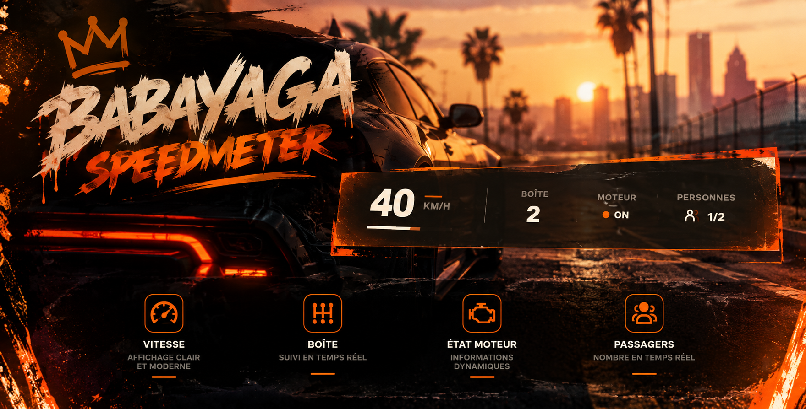

## 📸 Aperçu du Speedometer

# 🚗  Speedometer | HUD Véhicule FiveM

 Speedometer est un compteur de vitesse moderne, minimaliste et optimisé pour FiveM. Conçu pour offrir une expérience de conduite immersive, il affiche les informations essentielles de votre véhicule en temps réel, tout en conservant une interface élégante et discrète.

### ⚡ Fonctionnalités

- 🚀 **Vitesse en temps réel** : affichage précis de la vitesse en KM/H.
- ⚙️ **Rapport de vitesse** : indication du rapport actuellement engagé.
- 🔧 **État du moteur** : affichage ON/OFF avec indicateur lumineux.
- 👥 **Compteur d'occupants** : affiche le nombre de personnes présentes dans le véhicule par rapport au nombre de places disponibles.
- 📊 **Barre de progression** : indicateur visuel dynamique de la vitesse.
- 🎨 **Design minimaliste** : interface transparente, moderne et épurée.
- 🔴 **Alerte de vitesse** : affichage de la vitesse en rouge à partir de 180 km/h.
- 👁️ **Affichage automatique** : le HUD apparaît lorsque vous êtes conducteur et disparaît lorsque vous quittez le poste de conduite.
- ⚡ **Actualisation rapide** : mise à jour des informations toutes les 100 ms pendant la conduite.

### 🛠️ Informations techniques

- **Plateforme :** FiveM
- **Compatibilité :** ESX, QBCore et Standalone (aucune dépendance à un framework dans le code)
- **Langages :** Lua, HTML, CSS, JavaScript
- **Version :** 1.0.0
- **Créateur :** babayaga
- **Interface :** NUI

### 💎 Pourquoi choisir ce Speedometer ?

ce Speedometer privilégie la simplicité, la lisibilité et la fluidité. Son interface discrète, positionnée en bas de l'écran, permet aux joueurs de consulter rapidement les informations de leur véhicule sans encombrer leur champ de vision.

Ce  Speedometer — L'essentiel de votre conduite, avec style.
